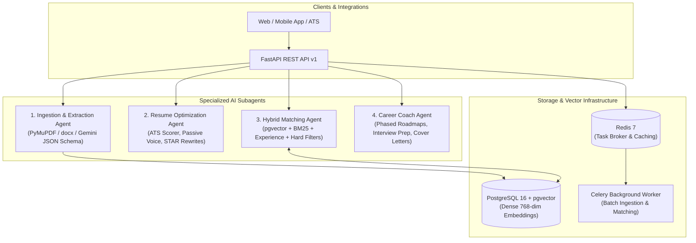

# Automated Resume Training & Job Matching Agents

A modular, production-ready distributed backend service built with **FastAPI**, **PostgreSQL (pgvector)**, **Google GenAI (Gemini)**, and **Celery/Redis**, orchestrating four specialized AI subagents for end-to-end resume ingestion, ATS optimization, hybrid vacancy matching, and career coaching.

---

## 1. System Architecture & The 4 AI Subagents



### The 4 Specialized Subagents:
1. **Ingestion & Extraction Agent (`extraction_agent.py`)**:
   - Parses multi-format documents (PDF via PyMuPDF/pdfplumber, DOCX via python-docx, and plain text/Markdown).
   - Extracts candidate work history, quantifiable achievements, skills taxonomy, and education into strongly-typed Pydantic schemas using Gemini structured JSON outputs.
2. **Resume Optimization & Training Agent (`optimization_agent.py`)**:
   - Audits resumes against target role archetypes and ATS compliance standards (0–100 score).
   - Detects weak bullet points (flagging passive voice and missing metrics).
   - Rewrites bullets into high-impact **STAR/CAR** format (Situation, Task, Action, Result).
   - Suggests high-value missing keywords and industry certifications.
3. **Job Matching & Compatibility Agent (`matching_agent.py`)**:
   - Implements a 4-dimensional hybrid matching engine:
     - **40% Vector Similarity**: Dense 768-dimensional cosine similarity in `pgvector`.
     - **35% Skill Coverage**: Exact, synonym, and BM25 token matching with weighted must-have (75%) vs nice-to-have (25%) skills.
     - **15% Experience Level & Title Alignment**: Total years parity and title progression.
     - **10% Hard Constraints Pass/Fail**: Visa sponsorship requirements and remote/onsite location policies.
   - Provides per-job gap analysis (`matching_skills`, `missing_must_have_skills`, `missing_nice_to_have_skills`).
4. **Career Coach / Action Plan Agent (`coaching_agent.py`)**:
   - Generates tailored multi-phase learning roadmaps with recommended readings, portfolio projects, and expected outcomes.
   - Creates targeted mock interview questions (System Design, Concurrency, Behavioral STAR).
   - Synthesizes customized cover letters tailored to target companies and job descriptions.

---

## 2. Directory Structure

```text
backend/
├── .agent/
│   └── skills/
│       ├── resume-parser.md             # Ingestion agent specification
│       └── jd-matcher.md                # Hybrid matching specification
├── alembic/
│   ├── env.py                           # Async Alembic migrations
│   ├── script.py.mako                   # Migration template with pgvector
│   └── versions/
│       └── 001_initial_schema.py        # Tables: candidates, jobs, matches
├── alembic.ini
├── app/
│   ├── api/
│   │   ├── v1/
│   │   │   ├── endpoints/
│   │   │   │   ├── resumes.py           # Upload, parse, profile endpoints
│   │   │   │   ├── jobs.py              # Vacancy indexing, listing, filters
│   │   │   │   ├── matching.py          # Top-k match-resume, match-job, compare
│   │   │   │   └── training.py          # Train, STAR rewrites, roadmaps, cover letters
│   │   │   └── router.py                # Consolidated v1 router
│   ├── core/
│   │   ├── config.py                    # Pydantic v2 BaseSettings
│   │   └── database.py                  # SQLAlchemy 2.0 async engine & sessions
│   ├── models/
│   │   ├── base.py                      # PortableVector (pgvector + SQLite fallback)
│   │   ├── candidate.py                 # CandidateProfile table
│   │   ├── job.py                       # JobPosting table
│   │   └── match.py                     # MatchResult table
│   ├── schemas/
│   │   ├── resume_schema.py             # Pydantic models for Candidate & Work History
│   │   ├── job_schema.py                # Pydantic models for Job Postings
│   │   ├── match_schema.py              # Pydantic models for 4D Match Breakdowns
│   │   └── coaching_schema.py           # STAR rewrites, Roadmaps & Cover Letters
│   ├── services/
│   │   ├── agents/
│   │   │   ├── extraction_agent.py      # Subagent 1
│   │   │   ├── optimization_agent.py    # Subagent 2
│   │   │   ├── matching_agent.py        # Subagent 3
│   │   │   └── coaching_agent.py        # Subagent 4
│   │   ├── embeddings.py                # 768-dim Google Gemini & local fallback
│   │   └── parser.py                    # PyMuPDF, python-docx, pdfplumber
│   ├── workers/
│   │   └── celery_worker.py             # Celery background tasks & Redis broker
│   └── main.py                          # FastAPI app entrypoint, CORS & OpenAPI
├── tests/
│   ├── conftest.py                      # In-memory async test DB & fixtures
│   ├── test_parser.py                   # Parsing tests (PDF, DOCX, TXT)
│   ├── test_agents.py                   # Extraction, Optimization & Coach agent tests
│   ├── test_embeddings.py               # Embedding vectors & cosine similarity
│   └── test_matching.py                 # Hybrid math & full HTTP API pipeline
├── docker-compose.yml                   # PostgreSQL (pgvector) + Redis + API + Worker
├── Dockerfile                           # Production container image
├── requirements.txt                     # Locked dependencies
└── .env.example                         # Example configuration template
```

---

## 3. Quickstart & Installation

### Option A: Running with Docker Compose (Recommended)

Start the full stack (PostgreSQL with pgvector, Redis, FastAPI backend, and Celery worker) with a single command:

```bash
cd backend
cp .env.example .env
docker compose up --build
```

The interactive OpenAPI documentation will be accessible at:
- **Swagger UI**: `http://localhost:8000/docs`
- **ReDoc**: `http://localhost:8000/redoc`

---

### Option B: Local Development Setup

1. **Prerequisites**: Python 3.11+, PostgreSQL 16 with `pgvector`, Redis.

2. **Create a virtual environment**:
   ```bash
   python -m venv venv
   # On Linux/macOS:
   source venv/bin/activate
   # On Windows:
   .\venv\Scripts\activate
   ```

3. **Install dependencies**:
   ```bash
   pip install -r requirements.txt
   ```

4. **Configure environment variables**:
   ```bash
   cp .env.example .env
   # Edit .env with your PostgreSQL credentials and GEMINI_API_KEY
   ```

5. **Run database migrations**:
   ```bash
   alembic upgrade head
   ```

6. **Start the FastAPI backend server**:
   ```bash
   uvicorn app.main:app --host 0.0.0.0 --port 8000 --reload
   ```

7. **Start the Celery worker (optional for async jobs)**:
   ```bash
   celery -A app.workers.celery_worker.celery_app worker --loglevel=info
   ```

---

## 4. API Endpoints Reference

### 1. Resume Ingestion
- `POST /api/v1/resumes/upload`
  - Accepts PDF, DOCX, or TXT file or raw text.
  - Extracts structured profile, generates 768-dim dense embedding, and persists candidate to database.
  ```bash
  curl -X POST "http://localhost:8000/api/v1/resumes/upload" \
    -F "file=@sample_resume.pdf"
  ```

### 2. Resume Training & Optimization
- `POST /api/v1/resumes/{id}/train`
  - Evaluates resume against target role or specific job posting.
  - Returns ATS score (0-100), detected passive voice/missing metrics, and STAR rewrites.
  ```bash
  curl -X POST "http://localhost:8000/api/v1/resumes/{candidate_id}/train" \
    -H "Content-Type: application/json" \
    -d '{"target_role": "Staff Backend Engineer"}'
  ```

### 3. Job Vacancies
- `POST /api/v1/jobs/`
  - Creates, enriches, and indexes a job description with pgvector embeddings.
  ```bash
  curl -X POST "http://localhost:8000/api/v1/jobs/" \
    -H "Content-Type: application/json" \
    -d '{
      "title": "Senior Backend Engineer",
      "company": "ScaleUp Tech",
      "description": "High-throughput microservices architecture.",
      "requirements": "Strong Python, FastAPI, Docker, and PostgreSQL experience.",
      "min_years_experience": 5.0,
      "required_skills": ["Python", "FastAPI", "PostgreSQL", "Docker"],
      "preferred_skills": ["Kubernetes", "Kafka", "Redis"],
      "remote_policy": "Remote",
      "visa_sponsorship": true
    }'
  ```
- `GET /api/v1/jobs/`
  - Lists job vacancies with query filters (`title`, `remote_policy`, `visa_sponsorship`).

### 4. Hybrid Matching & Gap Analysis
- `POST /api/v1/matching/match-resume/{resume_id}`
  - Returns top-k matching jobs ranked by compatibility score (0-100) with detailed gap analysis.
- `POST /api/v1/matching/match-job/{job_id}`
  - Returns top-k candidates for a specific vacancy.
- `POST /api/v1/matching/compare`
  - Instant head-to-head comparison between a candidate and a job posting.

### 5. Career Coaching & Action Plan
- `POST /api/v1/resumes/{id}/coaching-roadmap`
  - Generates phased learning roadmap, portfolio projects, and mock interview questions.
- `POST /api/v1/resumes/{id}/cover-letter`
  - Generates customized markdown cover letter connecting candidate achievements to target company needs.

---

## 5. Running the Test Suite

The test suite includes complete unit and integration tests with an in-memory async SQLite engine:

```bash
pytest -v
```

Output:
```text
tests/test_agents.py::test_extraction_agent_resume PASSED
tests/test_agents.py::test_extraction_agent_job_description PASSED
tests/test_agents.py::test_optimization_agent PASSED
tests/test_agents.py::test_coaching_agent PASSED
tests/test_embeddings.py::test_embedding_service_deterministic PASSED
tests/test_embeddings.py::test_embedding_batch PASSED
tests/test_matching.py::test_normalize_skill_synonyms PASSED
tests/test_matching.py::test_matching_agent_skill_coverage PASSED
tests/test_matching.py::test_matching_agent_experience_score PASSED
tests/test_matching.py::test_matching_agent_hard_constraints PASSED
tests/test_matching.py::test_matching_agent_hybrid_weights PASSED
tests/test_matching.py::test_full_api_matching_pipeline PASSED
tests/test_parser.py::test_clean_text PASSED
tests/test_parser.py::test_parse_txt PASSED
tests/test_parser.py::test_parse_docx PASSED
tests/test_parser.py::test_parse_pdf PASSED
tests/test_parser.py::test_parse_document_dispatcher PASSED

============================= 17 passed in 2.18s ==============================
```
